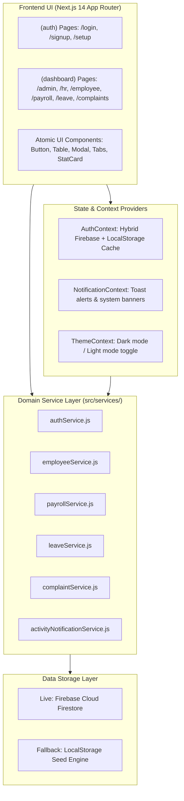

# HCM Lite — Complete Interview Prep & Architecture Guide

This comprehensive guide is designed to help you explain every aspect of **HCM Lite** during your technical interview with total confidence and mastery.

---

## 1. The 30-Second "Elevator Pitch"

> *"HCM Lite is an enterprise-grade Human Capital Management platform built with Next.js 14 App Router, Tailwind CSS, and a hybrid Firebase Firestore backend. It unifies the entire employee lifecycle—from ATS candidate recruitment and self-service onboarding to live attendance punch-clocking, statutory leave tracking, automated gross-to-net payroll disbursals with tax withholding, and a multi-tier grievance resolution pipeline between Employees, HR, and Admin. It features strict Role-Based Access Control (RBAC), real-time audit event notifications, and a responsive dark-mode enterprise UI designed for seamless desktop and mobile use."*

---

## 2. Tech Stack & Libraries Used (The "Why" Behind Each Tool)

When an interviewer asks: *"Which libraries did you use and why?"*

| Library | Version | Purpose in this Project | Why Chosen? |
| :--- | :--- | :--- | :--- |
| **Next.js (App Router)** | `14.2.20` | Full-stack framework (Pages, Layouts, API Route Handlers) | Provides unified client & server components, route groups `(auth)` & `(dashboard)`, nested layouts, fast static compilation, and edge-ready deployment on Vercel. |
| **React** | `18.3.1` | UI Library | Component-driven declarative architecture, state hooks (`useState`, `useEffect`, `useContext`), and fast hydration. |
| **Tailwind CSS** | `3.4.14` | Utility-first styling system | Rapid enterprise UI design, fine-grained responsive breakpoints (`min-[340px]`, `sm`, `md`, `lg`, `xl`), and seamless dark mode using Tailwind's `zinc` palette. |
| **Firebase Modular SDK** | `10.14.1` | Client Auth & Firestore NoSQL Database | Modern v10 tree-shakeable modular SDK (`firebase/auth`, `firebase/firestore`). Handles real-time cloud synchronization, multi-tenant collections, and user authentication. |
| **Firebase Admin SDK** | `12.6.0` | Node.js Server-Side Firebase Admin | Used inside Next.js API route handlers (`/api/employees`, `/api/payroll`, `/api/reports`) for secure backend operations that bypass client rules. |
| **Lucide React** | `0.460.0` | Enterprise Icon System | Clean, modern SVG icons (`Building2`, `Users`, `Clock`, `CreditCard`, `ShieldAlert`, `Bell`). Feather-light footprint and consistent stroke styling. |
| **Canvas Confetti** | `1.9.3` | Micro-interaction & Delight | Triggers celebratory confetti upon positive enterprise milestones (approving leave requests, finalizing payroll batches, hiring a candidate). |
| **Date-fns** | `3.6.0` | Date manipulation | Lightweight alternative to Moment.js for date calculations, working day diffs, and pay period timestamps. |
| **Clsx & Tailwind-Merge** | `2.1.1` & `2.5.4` | Class combination helper (`cn(...)`) | Located in `src/lib/utils.js`. Resolves conflicting Tailwind utility classes cleanly when props override default styles. |

---

## 3. High-Level Architecture & Data Flow



### Hybrid Storage Resilience (A Key Architecture Talking Point!)
- When live Firebase environment variables (`NEXT_PUBLIC_FIREBASE_API_KEY`, etc.) are configured, all operations sync to Cloud Firestore collections (`users`, `employees`, `attendance`, `leave_requests`, `payroll_runs`, `complaints`).
- If Firestore is offline or during a live offline demo, the app seamlessly falls back to pre-seeded browser `localStorage` (`src/lib/seedData.js`). The app **never crashes** if network connectivity drops.

---

## 4. Complete Route, Page & Component Directory Map

Here is the exact map of where everything is located in the codebase:

### Authentication & Setup Routes
| Route | Page File | Key Components & Modals | Functionality |
| :--- | :--- | :--- | :--- |
| `/login` | `src/app/(auth)/login/page.jsx` | `EnterpriseVectorHero.jsx`, `ForcePasswordChangeModal.jsx` | Multi-role selector (Admin/HR/Employee), 1-click demo personas, strict role verification check. |
| `/signup` | `src/app/(auth)/signup/page.jsx` | Form inputs, role/department selectors | Registers account, validates fields, creates user document in Firestore. |
| `/forgot-password` | `src/app/(auth)/forgot-password/page.jsx` | Email recovery form | Password reset link sender. |
| `/setup` | `src/app/(auth)/setup/page.jsx` | First-run wizard | Detects if company settings exist; if not, seeds initial data. |

### Dashboard & Core Module Routes
| Route | Page File | Key Services Used | Key Features & Buttons |
| :--- | :--- | :--- | :--- |
| `/dashboard` | `src/app/(dashboard)/dashboard/page.jsx` | `AuthContext` | Smart router that evaluates `user.role` and redirects to `/admin`, `/hr`, or `/employee`. |
| `/admin` | `src/app/(dashboard)/admin/page.jsx` | `employeeService`, `payrollService`, `complaintService` | Executive KPI metric cards, organization headcount, pending escalation badges, quick action buttons. |
| `/hr` | `src/app/(dashboard)/hr/page.jsx` | `employeeService`, `leaveService`, `complaintService` | People operations, pending leave approval count, candidate hiring progress, grievance inbox. |
| `/employee` | `src/app/(dashboard)/employee/page.jsx` | `attendanceService`, `leaveService`, `payrollService` | Self-service dashboard: 1-click punch in/out, remaining leave balance cards, recent pay voucher download. |
| `/employees` | `src/app/(dashboard)/employees/page.jsx` | `employeeService.js` | Employee Directory table, search bar, department filters, **"Add Employee"** modal (`EmployeeFormModal.jsx`). |
| `/employees/[id]` | `src/app/(dashboard)/employees/[id]/page.jsx` | `employeeService.js` | Detailed employee profile, job history, compensation breakdown, status change toggle. |
| `/attendance` | `src/app/(dashboard)/attendance/page.jsx` | `attendanceService.js` | Live clock terminal, Office vs Remote toggle, **"Punch Clock In/Out"** button, shift duration logs. |
| `/leave` | `src/app/(dashboard)/leave/page.jsx` | `leaveService.js` | Statutory balance cards (14 Annual, 8 Sick, 10 Casual), **"Request Time Off"** modal (`LeaveRequestModal.jsx`), Approve/Reject action buttons. |
| `/payroll` | `src/app/(dashboard)/payroll/page.jsx` | `payrollService.js` | Disbursal batches, **"Execute Payroll Batch"** modal (`RunPayrollModal.jsx`), **"View Payslip"** modal (`PayslipModal.jsx`), CSV direct deposit export. |
| `/complaints` | `src/app/(dashboard)/complaints/page.jsx` | `complaintService.js` | Grievance resolution board: **"File Grievance"** modal, filter tabs, HR investigation modal, Admin escalation & approval buttons. |
| `/recruitment` | `src/app/(dashboard)/recruitment/page.jsx` | `recruitmentService.js` | ATS Kanban board (Applied, Screened, Interview, Offer, Hired), candidate card drag/status buttons, candidate creation modal. |
| `/performance` | `src/app/(dashboard)/performance/page.jsx` | `performanceService.js` | Quarterly OKR milestones, 5-star scoring calibration matrix, manager review logs. |
| `/expenses` | `src/app/(dashboard)/expenses/page.jsx` | `expenseService.js` | Corporate expense claims table, receipt upload dialog, Approve/Reject expense buttons. |
| `/documents` | `src/app/(dashboard)/documents/page.jsx` | `documentService.js` | Corporate document repository, policy handbooks, download tracking. |
| `/reports` | `src/app/(dashboard)/reports/page.jsx` | `reportService.js` | System audit trails, headcount distribution charts, CSV audit log export. |
| `/settings` | `src/app/(dashboard)/settings/page.jsx` | `setupService.js` | Company metadata form (Legal name, EIN, address), Firebase cloud status indicator, Reset demo data button. |
| `/profile` | `src/app/(dashboard)/profile/page.jsx` | `employeeService.js` | Responsive user profile hero, personal info, salary history, review timeline, leave balances. |

### Global Layout Components (`src/components/layout/`)
- **`Sidebar.jsx`**: Collapsible left sidebar navigation dynamically filtered by role (`adminNavigation`, `hrNavigation`, `employeeNavigation`). Features a mobile drawer overlay.
- **`Topbar.jsx`**: Sticky top navigation bar containing:
  - Mobile hamburger toggle button
  - Global Search / Command Palette shortcut (`Ctrl + K`)
  - Real-Time Notification Center bell icon with unread badge count
  - Dark / Light Theme toggle
  - User Avatar with quick profile link
- **`NotificationCenter.jsx`**: Real-time dropdown notification panel. Formatted with mobile-responsive fixed positioning, single-tap dismiss backdrop, unread filter, and instant action simulator triggers.
- **`CommandPalette.jsx`**: Quick navigation modal (`Ctrl + K`) allowing instant jump to any module or action.

---

## 5. Key Domain Workflows (Explaining "How it Works")

### Workflow 1: Role-Based Authentication & Verification
- **Files**: `src/app/(auth)/login/page.jsx` & `src/context/AuthContext.jsx`
- **Logic**:
  - The login screen presents a role selector (`ADMIN`, `HR`, `EMPLOYEE`).
  - When the user submits, `signIn(email, password, selectedRole)` checks the user's registered role in Firestore.
  - **Security Rule**: If an HR user attempts to select the "Employee" or "Admin" tab, the system rejects the login with: *"Role mismatch: Your account is registered as HR. Please select the HR role tab to sign in."*
  - Temporary first-login passwords trigger `ForcePasswordChangeModal.jsx` before dashboard access is granted.

### Workflow 2: Professional Grievance & Complaints Resolution Pipeline
- **Files**: `src/services/complaintService.js` & `src/app/(dashboard)/complaints/page.jsx`
- **How it Works**:
  1. **Employee**: Submits a grievance (can be marked **Confidential** or **100% Anonymous** to protect whistleblowers). Status: `PENDING_HR`.
  2. **HR Partner**: Triages the grievance, adds confidential investigation notes, and interviews involved parties. Status: `INVESTIGATING`.
  3. **HR Escalation to Admin**: If policy changes, disciplinary actions, or financial compensation (e.g. retroactive overtime) are needed, HR clicks **"Escalate to Executive Admin"**. Status: `ESCALATED_TO_ADMIN`.
  4. **Admin Approval**: The Admin reviews the case findings and authorises budget or disciplinary actions. Status: `APPROVED_BY_ADMIN`.
  5. **Resolution**: HR/Admin logs the final remediation and closes the ticket. Status: `RESOLVED`.
  6. **Audit Broadcasting**: Every status transition automatically triggers `activityNotificationService.logActivity(...)`, updating the topbar bell for all authorized stakeholders.

### Workflow 3: Statutory Leave Accrual & Auto-Deduction
- **Files**: `src/services/leaveService.js` & `src/app/(dashboard)/leave/page.jsx`
- **How it Works**:
  - Every employee receives statutory quotas: **14 Annual**, **8 Sick**, and **10 Casual** days.
  - Date calculation automatically excludes weekends (`calculateWorkingDays`).
  - When an HR manager clicks **"Approve"**, `canvas-confetti` fires, the employee's remaining days are decremented in storage, and a broadcast notification is dispatched.

### Workflow 4: Payroll Batch Calculation & Gross-to-Net Slabs
- **Files**: `src/services/payrollService.js` & `src/app/(dashboard)/payroll/page.jsx`
- **Formula**:
  - Gross Salary = Basic * 1.5 (incorporates 40% Housing Allowance, 10% Medical).
  - Per-day deduction = Gross / Working Days (22 days).
  - Tax Withholding Slabs (Annualized):
    - `$0 – $100k`: 10%
    - `$100k – $200k`: 20%
    - `$200k+`: 30%
  - Net Pay = Gross − (Taxes + Attendance Deductions + Benefits).
  - Admins can export the direct deposit CSV file or generate printable PDF payslip vouchers.

---

## 6. How to Use GitHub Copilot in VS Code During the Interview

### Is using Copilot a good idea during an interview?
**YES, but with clear boundaries:**
- **The Good**: If the interviewer asks: *"Can you add a button to export this complaints table as CSV?"* or *"Can you add a filter for high-urgency complaints?"*, having `.github/copilot-instructions.md` configured means Copilot already knows your entire architecture, service methods, and styling rules. You can write a single comment or function signature, and Copilot will autocomplete the exact code needed.
- **The Caution**: **Never** open Copilot Chat on a shared screen and prompt: *"How does this project work?"* or *"Code this feature for me."* Interviewers want to see **your** architectural understanding. 

### How to use Copilot effectively:
1. **Use Inline Ghost Text (Tab to Complete)**:
   - Type a descriptive comment above where you need code:
     ```javascript
     // Filter complaints by urgency level: High or Urgent
     ```
   - Hit `Tab` when Copilot suggests the completion. This looks natural, fast, and shows you write clean, communicative code.
2. **If You Have Copilot Chat Open in VS Code**:
   - Reference the instruction file: `@workspace How is leave balance auto-deducted in leaveService?`
   - Ask for quick snippets: `@workspace Generate a modal for adding a new department with Input from components/ui/Input`
3. **Common Interview Modification Requests & How to Prompt Copilot**:
   - **Request**: *"Can you add a department filter dropdown to the complaints page?"*
     - In `complaints/page.jsx`, add: `// Dropdown select to filter complaints by department`
   - **Request**: *"Can you add an export to CSV button here?"*
     - Look at `src/lib/utils.js`: `exportToCSV(filename, data, headers)` is already built! Just call:
       ```javascript
       exportToCSV("complaints-report", filteredComplaints, { caseNumber: "Case #", title: "Title", status: "Status" });
       ```
   - **Request**: *"Can you add a new KPI card to the Admin dashboard?"*
     - In `admin/page.jsx`, use `<StatCard title="Active Grievances" value={complaintsCount} icon={ShieldAlert} />`.

---

## 7. Top 10 Technical Interview Questions & Perfect Answers

#### Q1: "Why did you choose Next.js 14 App Router instead of a standard Create React App or Vite SPA?"
> *"I chose Next.js 14 App Router because enterprise HR platforms require robust route grouping, layout persistence, and server-side API route handlers. With App Router, the `(dashboard)` layout persists navigation and state between page transitions without unmounting the sidebar or topbar. Furthermore, Next.js gives us server route handlers in `src/app/api` to interact securely with Firebase Admin SDK without exposing administrative credentials to the browser."*

#### Q2: "How is Role-Based Access Control (RBAC) enforced?"
> *"RBAC is enforced at both the UI and Context layers. In `src/context/AuthContext.jsx`, we normalize the user's role into canonical values: `ADMIN`, `HR`, or `EMPLOYEE`. The `Sidebar` dynamically filters visible navigation sections based on this role. On sensitive routes like `/payroll` execution or `/settings`, `useEffect` hooks check the role and redirect unauthorized users to their designated portal (`/employee` or `/hr`). On login, we enforce strict role matching so accounts cannot log into unauthorized roles."*

#### Q3: "How does the application manage state across components?"
> *"We utilize React Context for global app concerns: `AuthContext` handles user sessions, active roles, and demo persona switching; `NotificationContext` handles real-time toast alerts; and `ThemeContext` manages the dark/light enterprise theme. For local domain data, we use dedicated domain services (`src/services/`) that query Firestore or localStorage, keeping state localized to the components that need it to prevent unnecessary global re-renders."*

#### Q4: "How does the real-time notification system work?"
> *"Our notification engine in `activityNotificationService.js` operates as a central event bus. Whenever any critical event occurs—such as an Admin finalizing payroll, an HR partner escalating a grievance, or an employee clocking in—an event object is dispatched. The `NotificationCenter` component in the topbar listens to this stream and displays unread badges, timestamps, and priority tags with instant one-click navigation links to the relevant record."*

#### Q5: "How does the Grievance & Complaints module model corporate ethics compliance?"
> *"Complaints follow a strict multi-tier corporate lifecycle. Employees can submit complaints either under their name or anonymously to protect whistleblowers. The case enters HR triage (`PENDING_HR` -> `INVESTIGATING`). If the issue involves executive misconduct, policy changes, or financial payouts, HR escalates the ticket to Executive Admin (`ESCALATED_TO_ADMIN`). The Admin can sign off or request further review before the case is closed (`RESOLVED`). Every stage includes an audit trail with timestamps and investigator notes."*

#### Q6: "How does your design system handle mobile responsiveness?"
> *"Every component was built with mobile-first Tailwind constraints. Wide data tables are wrapped in horizontal touch-scrollable containers (`overflow-x-auto`). For navigation tabs, we implemented an `overflow-x-auto scrollbar-none` wrapper with `whitespace-nowrap shrink-0` tab items, preventing layout blowout on narrow 350px viewports. The Notification Center switches from an absolute dropdown on desktop to a responsive fixed modal with a backdrop on mobile."*

#### Q7: "How is payroll calculated in the system?"
> *"Payroll calculation lives in `payrollService.js` and `src/lib/utils.js`. It takes the employee's base annual salary, calculates monthly gross including housing (40%) and medical (10%) allowances, and determines the per-day wage based on 22 working days. Deductions are subtracted for unpaid absences or half-days. We then apply progressive annual tax withholding slabs (10% under $100k, 20% for $100k–$200k, and 30% above $200k) to compute net take-home pay."*

#### Q8: "What happens if Firebase credentials are missing or the user is offline?"
> *"We implemented a hybrid architecture. In `src/lib/firebase/client.js`, the app checks `isLiveFirebaseConfigured`. If Firebase credentials are not found, the service layer gracefully falls back to `src/lib/seedData.js` stored in `localStorage`. This ensures the app is 100% functional during local evaluation, demo presentations, or network outages."*

#### Q9: "Why pure JavaScript instead of TypeScript?"
> *"The project was architected in pure ES6+ JavaScript and JSX for rapid iterative development, maximum compatibility across Next.js 14 versions, and zero build compilation overhead. We maintain type safety and contract integrity through standardized constants (`src/lib/constants.js`), explicit prop defaults, and JSDoc documentation across all services."*

#### Q10: "If you had 2 more weeks to work on this, what would you add next?"
> *"I would implement three major enhancements:
> 1. WebSockets or Firebase real-time snapshot listeners for live push notifications across open browser tabs.
> 2. PDF generation on the server using `@react-pdf/renderer` so employees can download print-ready payslips.
> 3. Two-factor authentication (2FA) via SMS or authenticator apps for sensitive administrative actions like payroll disbursals."*
